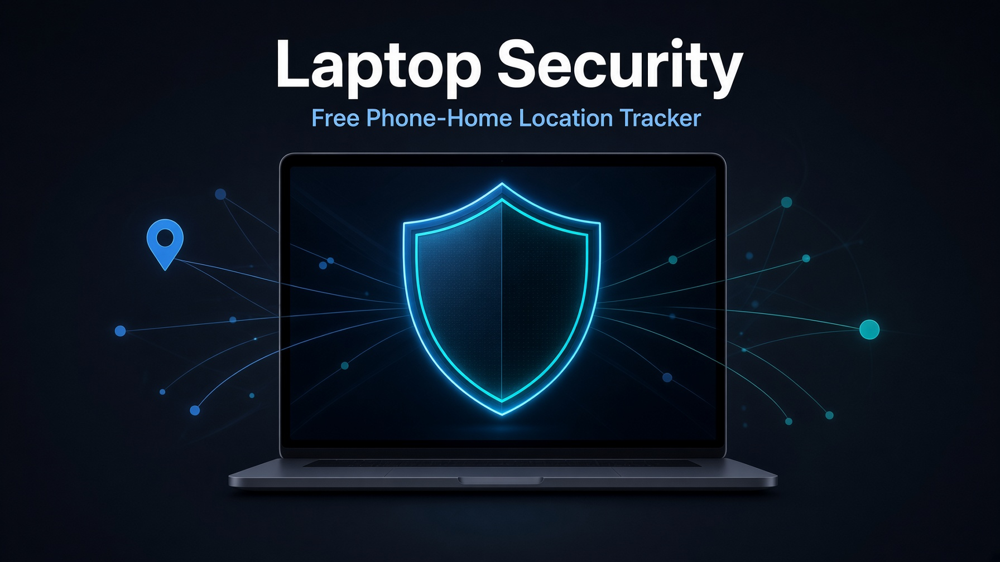

# Laptop Security — Phone-Home Location Tracker

A simple, free, open-source way to get a location notification the moment your laptop connects to any network (or changes networks).



**What it does**
- Sends a message (IP, approximate location, nearby Wi-Fi, hostname, uptime, battery) to Telegram (or any similar bot platform) on:
  - Boot / first network connection
  - Network change (new Wi-Fi, Ethernet, hotspot, etc.)
- Works as a lightweight backup to commercial tools like Prey.
- No ongoing cost if you use Telegram.

**Supported platforms**
- Linux (Ubuntu / NetworkManager)
- macOS
- Windows

## How to Get Your Telegram Bot Token and Chat ID

1. Open Telegram and search for **@BotFather**.
2. Send the command `/newbot`.
3. Follow the prompts: give your bot a display name and a username that ends in `bot` (example: `MyLaptopPingBot`).
4. BotFather will reply with a message that includes a long token that looks like `123456789:AAHxxxxxxxxxxxxxxxxxxxxxxxxxxxxxxx`. Copy this — it is your **BOT_TOKEN**.
5. Open a chat with your new bot (search for its username) and send it any message (for example "hello").
6. In a web browser, go to this address (replace the token with yours):
   ```
   https://api.telegram.org/botYOUR_BOT_TOKEN/getUpdates
   ```
7. Look for a section that contains `"chat":{"id":`. The number next to it is your **CHAT_ID**.

Keep both values private. If your bot token ever leaks, open BotFather again and send `/revoke` to generate a new one, then update your script.

## Quick Start

1. Create a Telegram bot and get your **BOT_TOKEN** and **CHAT_ID** using the steps above.
2. Follow the platform-specific instructions below.

## Platform Guides

- [Linux](linux/README.md)
- [macOS](mac/README.md)
- [Windows](windows/README.md)

## BIOS / UEFI Hardening (Stop Easy OS Wipes)

These steps make it much harder for a thief to boot a live USB and wipe your OS or data. Do them before or alongside the phone-home setup.

### Linux (and most PCs)
1. Reboot and enter BIOS/UEFI setup (usually **Esc**, **F2**, **F10**, or **Del** at the manufacturer logo).
2. Set a strong **Administrator / Supervisor password** under Security.
3. Disable external boot devices: USB, USB network boot, Wi-Fi network boot, PXE/network boot.
4. Enable **Secure Boot**.
5. On HP machines: also enable **Sure Start Secure Boot Keys Protection** and the **Microsoft UEFI CA key** so Linux can still boot.
6. Save and exit. Store the BIOS password offline.

### macOS
1. Restart and hold the power button to enter Recovery / Startup Options.
2. Go to Utilities → Startup Security Utility (or equivalent on your model).
3. Set a firmware password (on older Intel Macs) or enable the strongest available startup security.
4. Disable external boot media where the option exists.
5. On Apple Silicon, the system is already heavily locked down; the phone-home script still helps if someone gets past the lock screen.

### Windows
1. Enter BIOS/UEFI (usually **F2**, **F10**, **Del**, or **Esc**).
2. Set a strong Administrator / Supervisor password.
3. Disable USB and network boot options.
4. Enable Secure Boot.
5. Optionally enable TPM and BitLocker (for data encryption) in addition to the phone-home script.
6. Save and exit.

These BIOS locks stop most casual thieves from wiping the OS. The phone-home script then gives you a location signal the moment the machine connects to any network.

## Security Notes

- Keep your BOT_TOKEN private. If it is ever exposed, regenerate it immediately with `/revoke` in BotFather and update your script.
- This is a detection tool, not a lock. Pair it with the BIOS steps above for best results.
- A determined attacker with physical access and time can still remove software. The goal is to make opportunistic theft much harder and give you a recovery signal.

## License

MIT — use, modify, and share freely.
